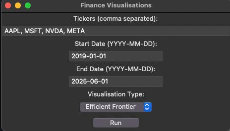
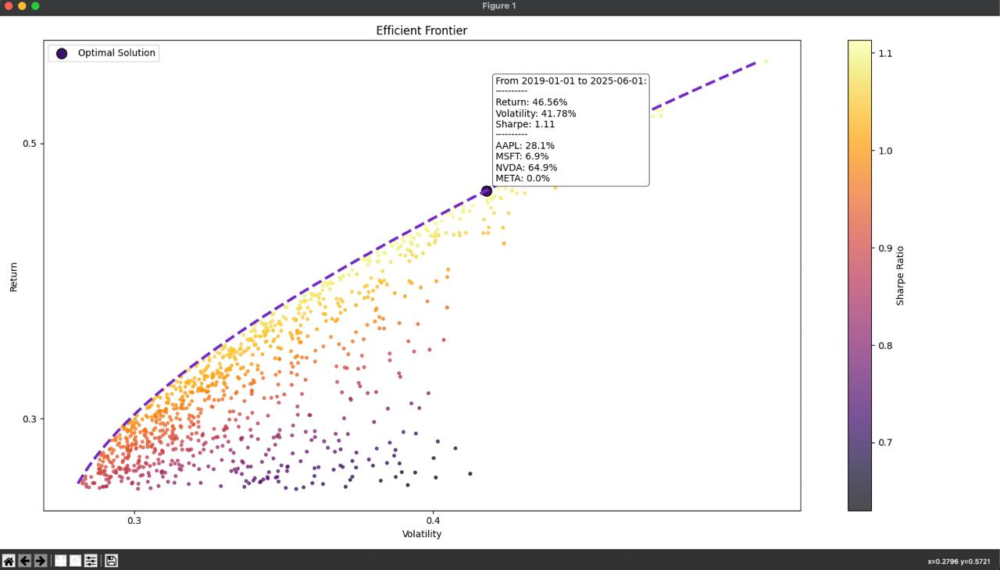

[EN](README.md) | [中文](README_CN.md)

## About
Finance Visualisations is a lightweight web app that lets you explore core portfolio analytics, including Efficient Frontier, VaR & CVaR, CAPM beta, Correlation Matrix, and Portfolio Performance, straight from live Yahoo Finance data.

The efficient frontier calculation part of this code is primarily based on the article by Fábio Neves, where you can find detailed explanations: [Plotting Markowitz Efficient Frontier with Python](https://towardsdatascience.com/python-markowitz-optimization-b5e1623060f5). I have extended this by integrating the Yahoo Finance API, allowing direct calculations using stock codes. Weights are generated using the Dirichlet distribution rather than the default uniform distribution, ensuring that the sum of weights equals 1.

## Install Dependencies
In the project folder, install the dependencies using the following command:

```
pip install -r requirements.txt
```

## How to Use (Web App)

1. Launch the Streamlit web app:

```
streamlit run streamlit_app.py
```

2. Use the sidebar to input tickers, select dates, set the risk-free rate, and choose an analysis type.

## A Few Notes

- Be aware that some companies, such as Bilibili which was listed in 2018, may not have accurate data if your start date is before their listing date.
- This uses the Yahoo Finance API; search for company codes with "company name + Yahoo Finance", e.g., "600519.SS" for Maotai, "AAPL" for Apple, and "0700.HK" for Tencent.
- The calculation results are for informational use only. Please be aware that investing involves risks, and decisions should be made with careful consideration.



