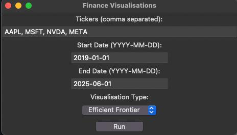
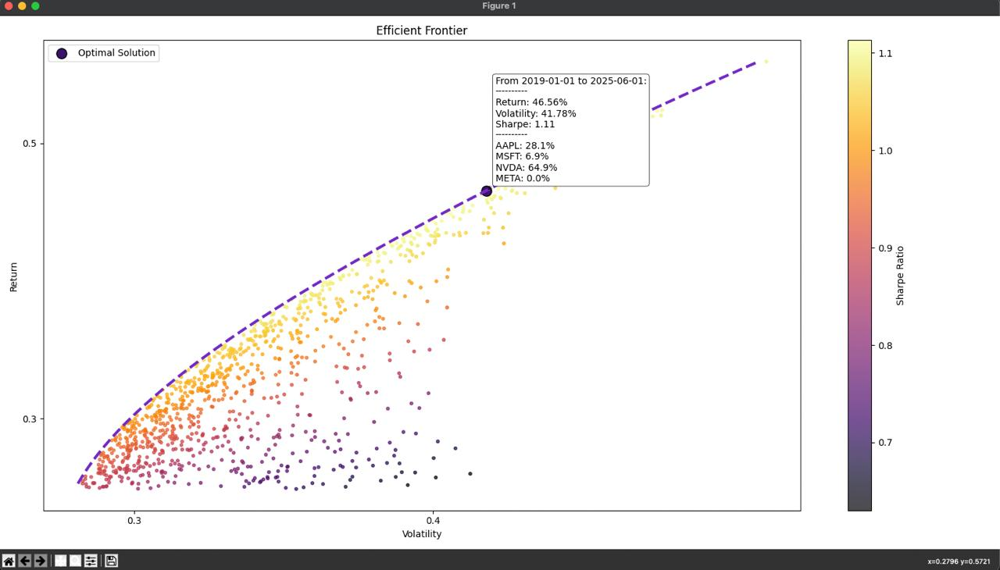
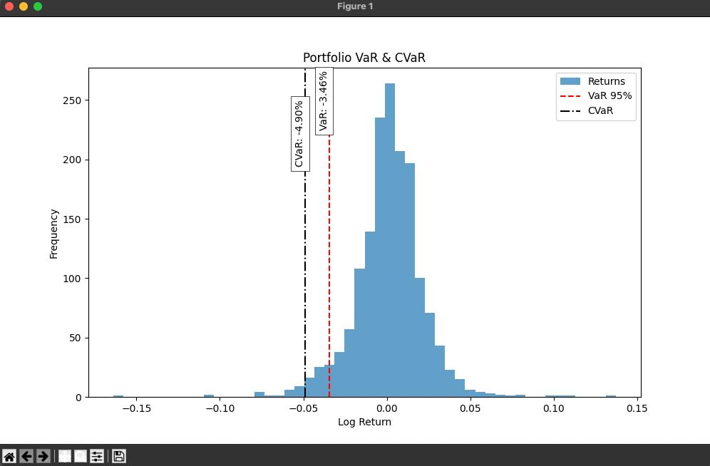
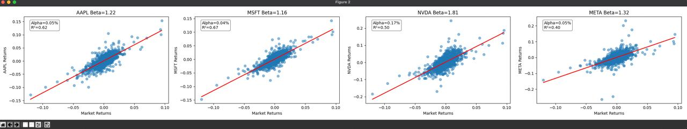

[EN](README.md) / [中文](README_CN.md)

## 关于
你只需输入（或直接使用默认的 AAPL、MSFT、NVDA、META）股票代码，工具就会自动抓取历史价格并生成有效前沿、风险价值与条件风险价值，以及CAPM回归图，帮助你直观比较收益、波动率与市场风险，未来还将持续加入更多可视化功能。

代码计算部分主要参考了Fábio Neves的文章，其中包含详细的解释：[Plotting Markowitz Efficient Frontier with Python](https://towardsdatascience.com/python-markowitz-optimization-b5e1623060f5)。我在此基础上加入了雅虎财经API的调用，可直接使用股票代码进行计算。在权重生成方面，我使用了狄利克雷分布而非默认的均匀分布，确保权重之和为1。


## 安装依赖
在项目文件夹中，使用以下命令安装依赖：

```
pip install -r requirements.txt
```

## 使用方法

1. 你现在可以直接运行整合了多种可视化的简单图形界面：

```
python gui_tool.py
```

## 一些说明

- 修改`start_date`和`end_date`。请注意，部分公司如Bilibili于2018年上市，如果开始日期早于上市日期，可能会导致数据不准确。

- 更改或添加`data_array`中的资产代号。此处使用雅虎财经API，你可以通过“公司名+雅虎财经”搜索对应的公司代号，如茅台是“600519.SS”，苹果是“AAPL”，腾讯是“0700.HK”。

- 计算结果仅供参考。投资有风险，入市需谨慎。




